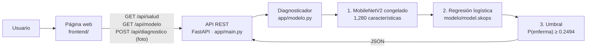

# Diagnóstico de hoja de maíz: API y página web

Servicio que recibe la foto de una hoja de maíz y responde si está sana o qué enfermedad tiene (Mancha gris, Tizón o Roya común). Es la fase 2 del proyecto de la app de diagnóstico para la asociación de productores: el modelo que se eligió y validó en las actividades 5 y 6 ahora queda empaquetado como una API REST con una página web que la consume.

- **Backend:** API REST con FastAPI (`app/`).
- **Frontend:** página HTML + JavaScript servida por la misma API (`frontend/`).
- **Modelo:** MobileNetV2 congelado como extractor de características + regresión logística (`modelo/`), con el umbral de decisión de la Actividad 6.

## Arquitectura



La foto se prepara igual que en el entrenamiento (RGB, 224×224), el extractor la convierte en 1,280 características y la regresión logística da la probabilidad de cada clase. Al final, la hoja se reporta como enferma si la probabilidad de enfermedad es de 0.2494 o más, aunque "Sana" sea la clase más probable, porque reportar como sana una hoja enferma es el error que más le cuesta al productor (Actividad 6).

## Estructura del repositorio

```
diagnostico-hoja-maiz-api/
├── app/
│   ├── main.py            endpoints de la API y servicio de la página web
│   ├── modelo.py          carga del modelo y diagnóstico de una foto
│   ├── config.py          configuración por variables de entorno
│   └── esquemas.py        forma de las respuestas (aparece en /docs)
├── frontend/              página web: index.html, app.js, estilos.css
├── modelo/
│   ├── model.skops        regresión logística de la Actividad 5
│   ├── MLmodel            metadatos originales de MLflow
│   └── ficha_modelo.json  origen, huella sha256, umbral y métricas de prueba
├── scripts/
│   ├── exportar_modelo.py      copia el modelo desde el MLflow de la Actividad 5 y lo verifica
│   └── descargar_extractor.py  baja MobileNetV2 al construir la imagen
├── pruebas/
│   ├── test_api.py        pruebas automáticas de los endpoints (pytest)
│   ├── probar_api.py      cliente que consume la API y guarda la evidencia
│   └── fotos_ejemplo.json fotos de prueba de la Actividad 5 que usa el cliente
├── evidencias/
│   ├── local/             la API corriendo con uvicorn en Windows
│   └── contenedor/        la API corriendo en Docker, con el log de la construcción
├── Dockerfile             receta de la imagen
├── .dockerignore          lo que no entra a la imagen
├── docker-compose.yml     levantar el servicio con la configuración de .env
├── requirements.txt       dependencias directas del servicio (versiones fijas)
├── constraints.txt        las 60 dependencias que se instalan en Linux con Python 3.10, todas fijas
├── requirements-dev.txt   dependencias para pruebas
└── .env.example           variables de configuración
```

## Endpoints

| Método | Ruta | Qué hace |
|---|---|---|
| `GET` | `/api/salud` | Estado del servicio y modelo cargado |
| `GET` | `/api/modelo` | Ficha del modelo: origen, clases, umbral y métricas de prueba |
| `POST` | `/api/diagnostico` | Recibe una foto (campo `foto`, multipart) y regresa el diagnóstico |
| `GET` | `/` | Página web |
| `GET` | `/docs` | Documentación interactiva (Swagger) generada por FastAPI |

Ejemplo con `curl`:

```bash
curl -F "foto=@hoja.jpg" http://localhost:8000/api/diagnostico
```

```json
{
  "archivo": "hoja.jpg",
  "diagnostico": "Roya común",
  "estado": "enferma",
  "probabilidad_enferma": 0.9992,
  "umbral_enferma": 0.2494,
  "clase_mas_probable": "Roya común",
  "decidido_por_umbral": false,
  "probabilidades": {"Roya común": 0.9788, "Mancha gris": 0.0204, "Sana": 0.0008, "Tizón": 0.0},
  "imagen": {"formato": "JPEG", "modo": "RGB", "ancho": 224, "alto": 224},
  "tiempo_ms": 32.4
}
```

Errores que regresa `POST /api/diagnostico`: **415** si el archivo no es una imagen, **413** si pesa más de 10 MB y **422** si no se manda el campo `foto`.

## Manual de despliegue con Docker

Es la forma recomendada: la imagen trae Linux, Python 3.10, las dependencias con sus versiones exactas, el extractor y el modelo, así que no hay que instalar nada más y el resultado es el mismo en cualquier máquina.

### Requisitos

- **Docker.** En Windows o Mac, Docker Desktop; en Windows además necesita WSL 2 (Docker Desktop lo instala, y puede pedir reiniciar). En Linux basta Docker Engine. Lo probé con Docker Desktop 4.97 (motor 29.9.2) en Windows 11.
- Unos **3 GB libres** en disco (la imagen pesa cerca de 2 GB).
- **Internet solo para construir** la imagen. Ya construida, el contenedor funciona sin conexión.
- El **puerto 8000** libre (o cualquier otro, ver más abajo).

Antes de empezar, `docker version` debe mostrar dos bloques, `Client` y `Server`. Si solo sale `Client` con un error, el motor de Docker no está corriendo (ver *Problemas comunes*).

### 1. Bajar el código

```bash
git clone https://github.com/RabindranathMunozPacheco/diagnostico-hoja-maiz-api.git
cd diagnostico-hoja-maiz-api
```

### 2. Construir la imagen

```bash
docker build -t diagnostico-hoja-maiz-api:0.2.0 .
```

La primera vez tarda unos 3 minutos, porque descarga las dependencias (1.4 GB, casi todo es PyTorch) y el extractor MobileNetV2. Si después solo cambia el código, Docker reutiliza esas capas y tarda segundos. Al final debe decir `naming to docker.io/library/diagnostico-hoja-maiz-api:0.2.0`.

### 3. Arrancar el contenedor

```bash
docker run -d --name diagnostico-hoja-maiz -p 8000:8000 diagnostico-hoja-maiz-api:0.2.0
```

- `-d` lo deja corriendo en segundo plano.
- `-p 8000:8000` publica el puerto 8000 del contenedor en el 8000 de la computadora. Para usar otro, se cambia el primero: `-p 8080:8000` y se abre http://localhost:8080.

### 4. Comprobar que funciona

```bash
docker ps
```

La columna `STATUS` debe decir `Up ... (healthy)`. El contenedor se revisa solo cada 30 segundos llamando a `/api/salud`; los primeros segundos dice `(health: starting)` mientras carga el modelo.

```bash
curl http://localhost:8000/api/salud          # en Windows PowerShell: curl.exe
# {"estado":"ok","modelo":"clasificador-hoja-maiz v1","version_api":"0.2.0"}
```

Después se abre http://localhost:8000 para la página web y http://localhost:8000/docs para la documentación de la API.

Para repetir las pruebas de integración contra el contenedor (desde la computadora, con Python 3.10 y `pip install -r requirements-dev.txt`):

```bash
python pruebas/probar_api.py --url http://localhost:8000 --salida evidencias/contenedor
```

### 5. Cambiar la configuración

Sin reconstruir la imagen, con variables de entorno:

```bash
docker run -d --name diagnostico-hoja-maiz -p 8000:8000 -e UMBRAL_ENFERMA=0.20 diagnostico-hoja-maiz-api:0.2.0
```

O con Docker Compose, que lee el archivo `.env`:

```bash
cp .env.example .env          # en cmd de Windows: copy .env.example .env
docker compose up -d --build  # construye y arranca
docker compose down           # detiene y borra el contenedor
```

### 6. Ver los registros, detener y borrar

```bash
docker logs -f diagnostico-hoja-maiz     # cada diagnóstico queda registrado con su P(enferma) y su tiempo
docker stop diagnostico-hoja-maiz
docker rm diagnostico-hoja-maiz
docker rmi diagnostico-hoja-maiz-api:0.2.0   # borra la imagen, si ya no se necesita
```

### Problemas comunes

| Mensaje | Qué pasa | Solución |
|---|---|---|
| `failed to connect to the docker API at npipe:////./pipe/dockerDesktopLinuxEngine` | Docker Desktop no está abierto o su motor no arrancó | Abrir Docker Desktop y esperar a que diga *Engine running*. A mí me pasó justo después de instalar WSL, y se arregló reiniciando la PC |
| `docker` no se reconoce como comando | La terminal se abrió antes de instalar Docker | Cerrarla y abrir otra |
| `Bind for 0.0.0.0:8000 failed: port is already allocated` | Otro programa usa el puerto 8000 (por ejemplo, la API corriendo con uvicorn) | Detener ese programa o usar `-p 8080:8000` |
| `Conflict. The container name "/diagnostico-hoja-maiz" is already in use` | Ya existe un contenedor con ese nombre | `docker rm -f diagnostico-hoja-maiz` y volver a correr |
| El contenedor sale `unhealthy` o se detiene | El servicio no arrancó | `docker logs diagnostico-hoja-maiz`. Si dice que `model.skops` no coincide con la huella, el archivo del modelo cambió o se dañó y hay que bajarlo otra vez del repositorio |

### Qué hace el Dockerfile

- **Base `python:3.10-slim`**, la misma versión de Python con la que se entrenó el modelo.
- **Las dependencias se instalan primero**, con `requirements.txt` y `constraints.txt`, para que esa capa se reutilice cuando solo cambia el código. PyTorch va en su versión solo-CPU, porque la de PyPI trae CUDA y pesa varios GB más.
- **El extractor se descarga al construir** en la revisión fija de la ficha, y luego se activa `HF_HUB_OFFLINE=1`: el contenedor no depende de internet ni de que el modelo siga publicado en Hugging Face.
- **Corre con un usuario sin privilegios** (`servicio`), no como root.
- **`HEALTHCHECK`** llama a `/api/salud` cada 30 segundos.
- **La configuración entra por variables de entorno** (`UMBRAL_ENFERMA`, `TAMANO_MAX_MB`) con los valores de la Actividad 6 por defecto.

### Validación del contenedor

Corrí `probar_api.py` contra el contenedor y comparé sus respuestas con las de la API corriendo en Windows: las 8 fotos de ejemplo dieron el mismo diagnóstico y las mismas probabilidades (diferencia 0 con 4 decimales), y los errores 413 y 415 también salieron igual. La evidencia está en `evidencias/contenedor/`, junto con el log completo de `docker build`.

## Cómo correrlo en local (sin contenedor)

Requiere Python 3.10.

```bash
python -m venv .venv
.venv\Scripts\activate             # en Linux o Mac: source .venv/bin/activate
pip install -r requirements-dev.txt
uvicorn app.main:app --port 8000
```

La primera vez descarga el extractor MobileNetV2 de Hugging Face (9 MB). Después se abre http://localhost:8000 para la página web o http://localhost:8000/docs para la documentación de la API.

## Configuración

Se cambia con variables de entorno, sin tocar el código (ver `.env.example`):

| Variable | Por defecto | Para qué sirve |
|---|---|---|
| `UMBRAL_ENFERMA` | `0.2494` | Probabilidad de enfermedad desde la que se reporta enferma |
| `TAMANO_MAX_MB` | `10` | Tamaño máximo de la foto |
| `DIR_MODELO` | `modelo/` | Carpeta con `model.skops` y `ficha_modelo.json` |

## Pruebas y evidencias

```bash
python -m pytest pruebas -v                                     # pruebas automáticas
python pruebas/probar_api.py --url http://localhost:8000        # cliente contra la API levantada
```

`probar_api.py` llama a todos los endpoints, manda las 8 fotos de ejemplo (2 por clase, de la prueba de la Actividad 5) y dos archivos con error, y guarda las respuestas JSON, un CSV con cada petición y un `resumen.md`. Por defecto escribe en `evidencias/local/`; con `--salida evidencias/contenedor` guarda la corrida contra Docker. Cada carpeta tiene en `capturas/` las imágenes de la documentación y de la página web.

## Origen del modelo

El modelo es `clasificador-hoja-maiz` v1 (alias `candidato`) del Model Registry de la [Actividad 5](https://github.com/RabindranathMunozPacheco/Actividad-5). `scripts/exportar_modelo.py` lo copia desde ese MLflow, vuelve a calcular sus métricas con las mismas 221 fotos de prueba y comprueba que coinciden con las registradas. La ficha guarda la huella sha256 del archivo, y la API se niega a arrancar si el archivo no coincide con ella.

| Métrica en prueba (221 fotos de parcela) | Valor |
|---|---|
| F1 macro | 0.72 |
| Exactitud | 0.75 |
| Hojas enfermas reportadas como sanas, sin umbral | 11.4 % |
| Hojas enfermas reportadas como sanas, con umbral 0.2494 | 8.0 % |
| Hojas sanas reportadas como enfermas, con umbral 0.2494 | 55.6 % |

Comprobé que la API calcula las mismas características que el entrenamiento: con 40 fotos del dataset la diferencia máxima fue de 4×10⁻⁶ y las 40 dieron la misma clase.

**Limitaciones.** El modelo solo conoce cuatro clases, así que a una foto que no es de hoja de maíz también le asigna una de ellas (una imagen verde lisa sale como Roya común). Todavía no llega a la meta de F1 ≥ 0.85 del business case, y las fotos de entrenamiento no son de Sinaloa. Es una herramienta de apoyo y no sustituye la revisión de un agrónomo.

## Créditos

- Extractor: [`linkanjarad/mobilenet_v2_1.0_224-plant-disease-identification`](https://huggingface.co/linkanjarad/mobilenet_v2_1.0_224-plant-disease-identification), revisión `c1861579`.
- Fotos: [`muAtarist/maize_foliar_diseases`](https://huggingface.co/datasets/muAtarist/maize_foliar_diseases), revisión `448bec6c`. No se incluyen en el repositorio porque el dataset no declara licencia; los scripts las descargan del origen.
- Rabindranath Muñoz Pacheco, Gestión de proyectos de inteligencia artificial, Universidad Tecmilenio.
